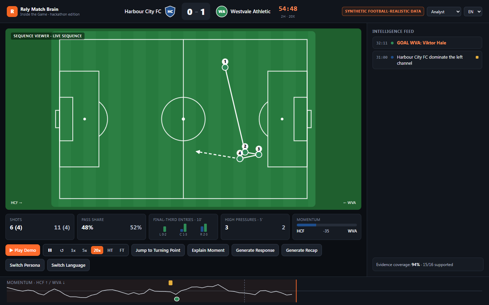
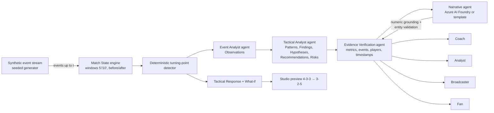
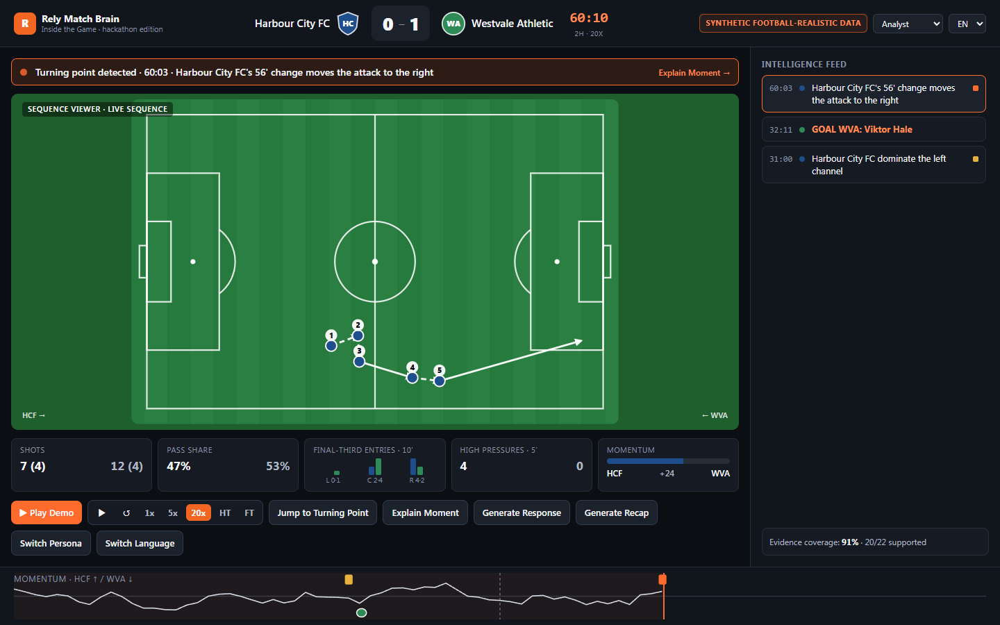
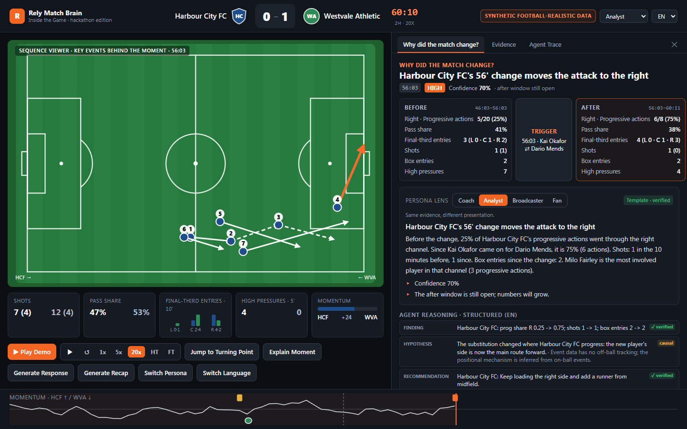
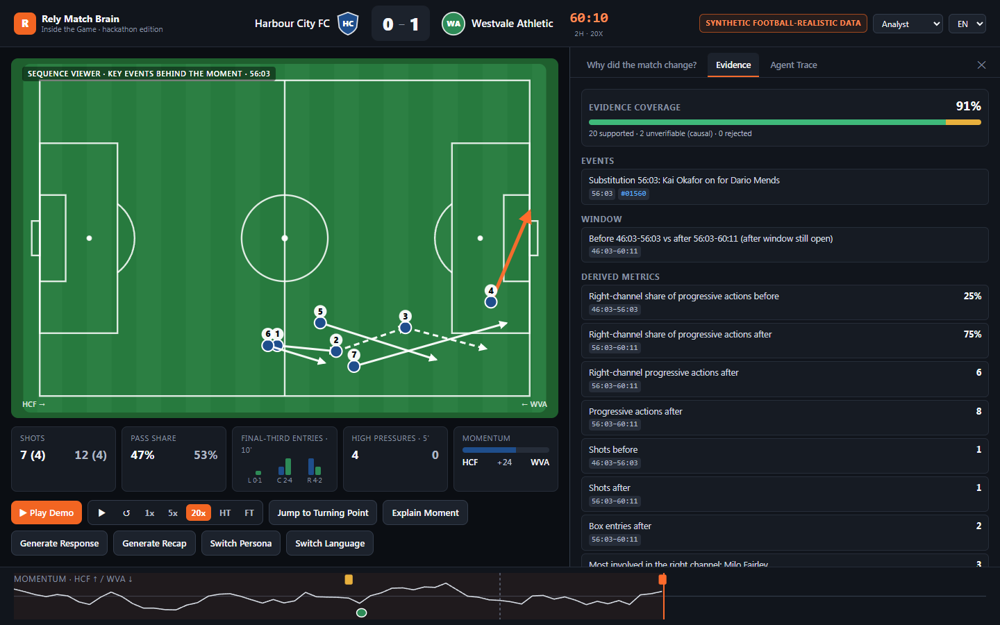
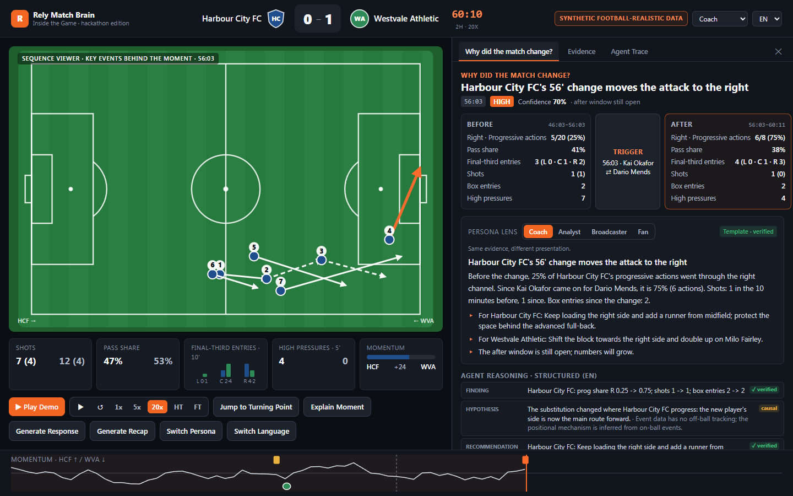
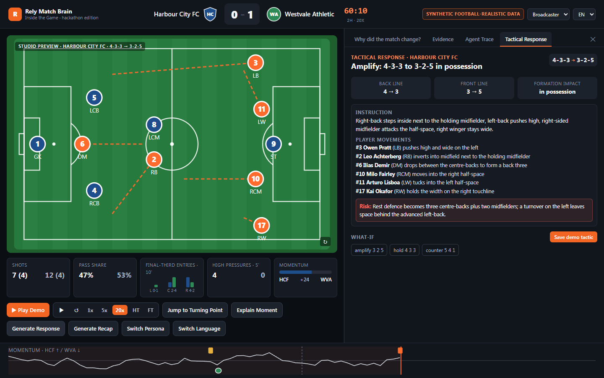
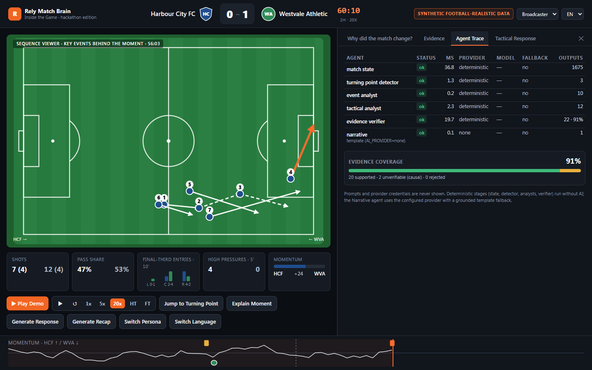
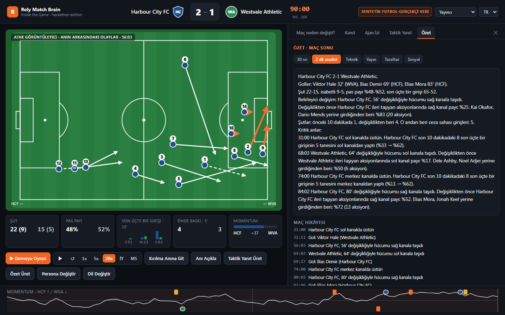
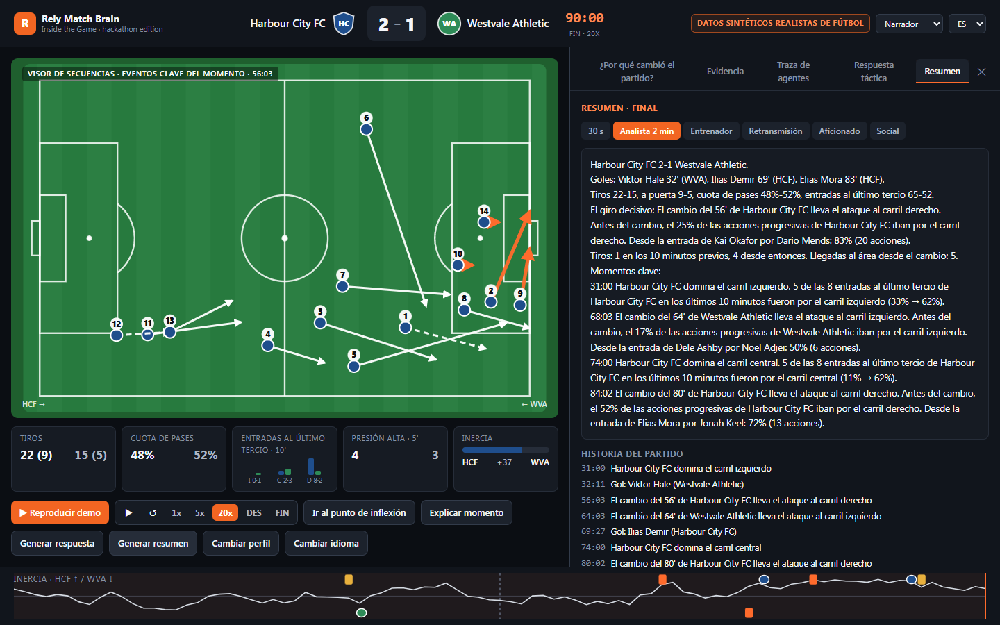

# Rely Match Brain

**From football events to understanding. From understanding to decisions.**

Rely Match Brain is an event-driven football reasoning system. It watches a live stream of match events, keeps a
precise match state, detects the moments where a match actually changes with deterministic rules, and then lets a
small team of AI agents explain those moments for a coach, an analyst, a broadcaster or a fan. It works in English,
Turkish and Spanish, and every number it shows can be traced back to the events it came from.

> **Synthetic data only.** Every club, player and event in this repository is fictional and generated by a seeded
> simulator (`synthetic-data/`). The repository contains no real match data, real player data or club marks.
> The UI labels all data as **SYNTHETIC FOOTBALL-REALISTIC DATA**.



---

## Hackathon challenge

Built for **Inside the Game: Developer Hackathon** (Microsoft + Premier League). The challenge asks how AI can help
people understand football more deeply. Our answer is a system that can answer **"Why did the match change?"**
while the match is still being played, and that shows its evidence.
See [docs/HACKATHON_ALIGNMENT.md](docs/HACKATHON_ALIGNMENT.md).

## Problem

Match data comes as thousands of events (passes, carries, pressures, shots). Coaches, analysts, broadcasters and fans
all ask the same question: *what just changed, and why?* Today the answer is either a human watching video for hours
or a generic AI summary that can invent numbers, players and causes.

## Solution

Rely Match Brain separates **facts** from **language**:

1. A **Match State engine** recomputes everything from the events received so far. It never uses future data, and tests
   enforce this.
2. A **deterministic turning-point detector** decides *what* changed (substitution followed by a channel shift, red card,
   shot surge, momentum swing, channel dominance, possession swing, repeated dangerous sequences). AI does not decide this.
3. **Agents** turn those facts into typed intelligence. An **Evidence Verifier** checks every metric, event, player and
   timestamp, and a **Narrative agent** (Azure AI Foundry, or a deterministic template) explains the moment for each persona
   and language.
4. The UI shows **Before → Trigger → After**, the **Evidence**, the **Explanation** and the **Confidence**, plus a
   **Tactical Response** with a Studio-style animated preview.

## Key capabilities

| Capability | What you see |
|---|---|
| Synthetic live playback | Play / Pause / Restart, 1x / 5x / 20x, HT, FT, Jump to Turning Point. Events stream progressively. |
| Match State | Score, clock, possession (pass share), shots, final-third entries by channel, pressures, recoveries, momentum, 5'/10' windows |
| Turning points | 7 deterministic rules plus goals, live cut-off semantics, clustering to avoid spam |
| "Why did the match change?" | Before / Trigger / After windows, explanation, confidence, sequence viewer with numbered arrows |
| Evidence panel | Event ids, timestamps, windows, derived metrics, sequences, rule text, honest evidence coverage |
| Persona lens | Coach / Analyst / Broadcaster / Fan: same evidence, different presentation |
| EN / TR / ES | Language changes wording only; facts are never recomputed (tested) |
| Tactical Response | 4-3-3 → 3-2-5 Studio preview (RB inverts, LB high, CM to half-space, RW wide), instruction, risk, what-if (no score prediction), save demo tactic locally |
| Recaps | 30-second, 2-minute analyst, coach, broadcast, fan, social; Match Story chapters only with evidence |
| Agent Trace | Per-agent latency, provider, model, fallback status, evidence coverage (no prompts, no secrets) |

## Multi-agent architecture



- **Shared state is explicit.** Agents read and write typed fields on one `SharedState` object
  (`apps/api/rely_brain/agents/base.py`).
- **Per-agent recovery.** If the Tactical Analyst fails, Event Analyst output remains. If the Narrative agent fails, the
  structured intelligence remains and the UI shows "AI explanation unavailable". Covered by tests and evals.
- **Grounding.** Narrative text may only use numbers present in the moment's facts and only names in the roster. One
  regeneration with the issues listed; otherwise the grounded template is used.

More detail: [docs/architecture](docs/architecture/README.md).

## Microsoft technologies and why

| Technology | Use | Why |
|---|---|---|
| **Azure AI Foundry** (model inference via `azure-ai-inference`) | Narrative agent: persona and language explanations as structured JSON, with streaming support | One endpoint for many models, JSON output, enterprise auth and content safety |
| **Azure Container Apps** | API + web containers with liveness/readiness/startup probes, autoscale (`infra/azure/main.bicep`) | Serverless containers, HTTP scaling, no cluster to run |
| **Azure Container Registry** | Image builds (`az acr build`) | Builds in the cloud, no local Docker needed |
| **Azure Monitor / Log Analytics** | Structured JSON logs with latencies from the API | Query agent latency, fallback rates and errors |
| **GitHub Actions** | CI: tests, lint, typecheck, build, eval smoke, Docker builds, gitleaks | Every change is checked |
| TypeScript / Next.js, Python / FastAPI | Web and API | Typed end to end (pydantic ↔ TypeScript types) |

**Status, stated plainly:** the Foundry provider is implemented and unit-tested with fake clients. No Foundry
credentials were available while building it, so **no live Foundry call has been made yet**, and the default is
`AI_PROVIDER=none`, which uses deterministic templates. The Azure deployment files are written but **have not been
deployed yet**. See [docs/foundry](docs/foundry/README.md).

## Synthetic data statement

- Five seeded matches (`synthetic-data/matches/*.json`), generated by `synthetic-data/generators/generate.py`
  (standard library only, deterministic by seed). CI regenerates them and fails if they differ.
- Fictional clubs: Harbour City FC, Westvale Athletic, Kingsmere Rovers, Elmstead Town. Crests are geometric shapes
  with initials.
- Event schema: `synthetic-data/schemas/event.schema.json` (fields `event_id, match_id, period, match_second, minute,
  second, team_id, player_id, event_type, outcome, start_x/y, end_x/y, possession_id, sequence_id, qualifiers, metadata`;
  18 event types).

| Scenario | Match id | Events | Story |
|---|---|---|---|
| tactical_shift (demo) | `hcf-wva-tactical-shift` | 2,504 | 56' substitution moves Harbour City's attack to the right; detected at 60:03 |
| red_card | `kmr-elt-red-card` | 2,420 | Elmstead down to ten at 38'; Kingsmere's pass share and territory rise, Elmstead's block drops deeper |
| late_comeback | `wva-kmr-late-comeback` | 2,551 | Westvale trail and surge from 70'. The surge is flagged before the 82' equaliser |
| balanced | `elt-hcf-balanced` | 2,599 | Even contest |
| high_press | `kmr-hcf-high-press` | 2,703 | A high press that fades after 60' |

## Explainability

Every turning point carries: the rule that fired (with thresholds), the trigger event, before/after windows
(`[start, end)` in match seconds, never past the cut-off), derived metrics with metric paths, the linked event ids, and
a confidence derived from effect size and sample size. The Evidence Verifier re-computes every referenced metric from
raw events and reports **evidence coverage = supported claims / all claims**. Hypotheses are causal, so they always
count as "unverifiable". Coverage is therefore honest and below 100% (91% in the demo).

## Demo flow (under 2 minutes)

`/` opens the demo directly; `/?demo=1` is recording mode (deterministic, no debug info, shortened ids).

1. **Play Demo**: starts at 50:00 at 20x. The turning point is detected at **60:03**, about **31 s** after pressing play.
2. **Explain Moment**: Before / Trigger / After, Evidence, Confidence.
3. **Switch Persona** and **Switch Language**: same evidence, different presentation.
4. **Generate Response**: 4-3-3 → 3-2-5 Studio preview, instruction, risk, what-if.
5. **Agent Trace** and **Generate Recap** (EN / TR / ES).

Full script with time slots: [docs/DEMO_SCRIPT.md](docs/DEMO_SCRIPT.md).

## Run locally

Requirements: Python 3.12, Node 22+, pnpm.

```bash
# API (http://127.0.0.1:8100)
cd apps/api
python -m venv .venv && . .venv/Scripts/activate   # Windows Git Bash; use .venv/bin/activate on macOS/Linux
pip install -r requirements-dev.txt
uvicorn main:app --host 127.0.0.1 --port 8100

# Web (http://127.0.0.1:3100)
cd apps/web
pnpm install
pnpm dev
```

Or with Docker: `docker compose up --build` (API on 8100, web on 3100).

Optional Azure AI Foundry: copy `.env.example` to `.env` (git-ignored), set `AI_PROVIDER=microsoft_foundry`,
`FOUNDRY_ENDPOINT`, `FOUNDRY_API_KEY`, `FOUNDRY_MODEL`, and export them before starting the API.

Tests:

```bash
cd apps/api && pytest -q && ruff check . && python -m evals.run_evals
cd apps/web && pnpm test && pnpm lint && pnpm typecheck && pnpm build
```

Regenerate data: `python synthetic-data/generators/generate.py` (seeds are chosen with
`synthetic-data/generators/select_seeds.py`, which keeps the first seed whose match meets each scenario's
acceptance criteria and realism bounds).

## Deploy

`infra/azure/deploy.sh` creates a resource group, ACR, builds both images with `az acr build`, and deploys
`infra/azure/main.bicep` (Container Apps environment + API + web, Log Analytics, health probes on `/health` and
`/ready`). Foundry settings are passed from environment variables as secure parameters and never committed.
This path has **not been run yet** (no Azure subscription was available during development).

## AI evaluation

`apps/api/evals/run_evals.py` runs offline. It uses deterministic templates and scripted fake LLM replies that
deliberately include invented numbers, unknown players and timeouts.
Categories: turning-point explanation, numeric grounding, unsupported event rejection, persona style, language
adherence, recommendation grounding, agent failure fallback. Latest full run: **85/85 cases passed**
([report](apps/api/evals/report.md)). CI runs the smoke subset.

## Screenshots

| | |
|---|---|
|  Turning point detected |  Why did the match change? |
|  Evidence panel |  Persona lens (coach) |
|  Tactical response, 4-3-3 → 3-2-5 |  Agent trace |
|  Recap in Turkish |  Recap in Spanish |

## Future potential

- Tracking-data inputs (off-ball positions) to confirm the positional mechanisms that event data can only infer.
- Foundry evaluations and content safety in CI once credentials are available, plus model comparison using the eval suite.
- Club-specific style guides for the Narrative agent; voice output for broadcasters.
- Streaming the event feed from a real provider adapter (the engine already consumes events incrementally).

## License

MIT. See [LICENSE](LICENSE). Built for the "Inside the Game" hackathon. Not affiliated with or endorsed by the
Premier League or any club.
